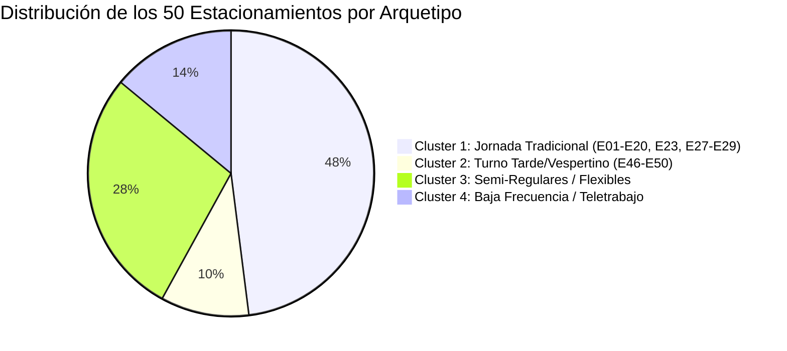

# Reporte de Análisis de Datos y Propuesta de Negocio
## Gestión de Estacionamientos Particulares Compartidos
**Proyecto Integrador de Ciclo Básico — Caso HEI ICIF**

---

## 1. Resumen Ejecutivo y Metodología

El presente informe expone el análisis estadístico y de comportamiento derivado del archivo `Data/dataset_estacionamientos.csv`, con el objetivo de estructurar una propuesta de negocio tecnológicamente factible, económicamente viable y socialmente aceptable para la comunidad de un edificio residencial ubicado en un polo de alta actividad urbana.

### Parámetros del Dataset Analizado:
* **Período de observación:** 4 semanas hábiles (20 días laborables, lunes a viernes).
* **Granularidad temporal:** Intervalos de 30 minutos entre las 06:00 y las 23:30 horas (36 mediciones diarias; 720 intervalos en total).
* **Parque vehicular:** 50 estacionamientos privados (E01 al E50).
* **Semántica de los datos:** En el registro de disponibilidad, `1` indica que el estacionamiento se encuentra libre/desocupado (el propietario no está utilizando el espacio), mientras que `0` representa que el espacio está ocupado por el residente.
* **Métrica global:** Sobre un total de 36.000 observaciones punto-tiempo, se registran **15.289 medias horas libres**, equivalentes a **7.644,5 horas-estacionamiento de capacidad ociosa mensual**.

---

## 2. Análisis de Patrones de Comportamiento

### 2.1. El Ciclo Diario: La Curva de Vacancia Laboral
El análisis temporal demuestra una **simbiosis perfecta** entre la rutina de los residentes y la curva de demanda del entorno urbano (oficinas, universidades, comercio y servicios):

```
Capacidad
Ociosa (Cupos)
  50 ┤
  40 ┤                   ╭────────────────────╮
  30 ┤              ╭────╯                    ╰───╮
  20 ┤         ╭────╯                             ╰────╮
  10 ┤    ╭────╯                                       ╰────╮
   0 ┼────┴──────┴──────┴──────┴──────┴──────┴──────┴──────┴────┴──
    06:00 07:30 09:00 11:00 13:00 15:30 17:00 18:30 20:00 22:00
```

1. **Rampa Matutina (06:00 – 08:30):** La disponibilidad salta de 0 a 29,15 cupos libres en promedio. Los residentes salen de sus hogares hacia sus lugares de estudio o trabajo.
2. **Meseta de Alta Disponibilidad (09:00 – 17:00):** Durante las 8 horas de horario laboral central, el edificio promedia **35,41 estacionamientos desocupados simultáneamente** (70,8% de la capacidad total del edificio). La hora de máxima vacancia se registra a las **15:30 hrs con un promedio de 41,2 espacios libres (82,4%)**.
3. **Rampa de Retorno Vespertino (17:30 – 20:00):** Se produce el retorno paulatino de los residentes; la vacancia desciende bruscamente de 32,0 a 3,95 espacios libres.
4. **Ventana Nocturna (20:30 – 06:00):** Disponibilidad prácticamente nula (< 2 espacios). Los residentes duermen en el edificio y requieren su estacionamiento al 100%.

---

### 2.2. Variación Semanal: El "Efecto Viernes"
El comportamiento de los días de la semana es altamente consistente de lunes a jueves, pero presenta una alteración crítica los viernes por la tarde:

| Horario | Lunes | Martes | Miércoles | Jueves | Viernes | Diferencia Viernes vs. Promedio Lu-Ju |
| :---: | :---: | :---: | :---: | :---: | :---: | :---: |
| **09:00** | 33,50 | 35,00 | 36,25 | 34,25 | **33,25** | -1,50 |
| **13:00** | 33,00 | 35,50 | 35,00 | 36,00 | **32,50** | -2,38 |
| **15:30** | 39,75 | 43,25 | 42,25 | 41,25 | **39,50** | -2,12 |
| **17:00** | 38,50 | 41,25 | 41,50 | 39,75 | **28,00** | **-12,25 (Retorno anticipado)** |
| **17:30** | 32,75 | 37,25 | 36,00 | 32,75 | **21,25** | **-13,44** |
| **18:00** | 27,25 | 30,75 | 28,50 | 25,75 | **14,00** | **-14,06** |

> **Hallazgo Operativo:** Los viernes los residentes regresan entre 60 y 90 minutos antes a sus hogares o utilizan sus vehículos para actividades de fin de semana. Cualquier producto de "Jornada Laboral" para los viernes debe concluir obligatoriamente a las **16:30 hrs** para evitar fricciones.

---

### 2.3. Distribución de los Bloques de Disponibilidad
Al medir la duración ininterrumpida en que un estacionamiento permanece libre, la distribución resulta ser marcadamente bimodal:

* **Bloques Continuos Largos (8 a 12 horas seguidas):** Concentran **542 eventos (45,7% del total)**, con una mediana de 7,5 horas. Representan la base estructural para vender **Abonos Laborales Mensuales/Diarios**.
* **Bloques Continuos Cortos (1 a 4 horas):** Concentran **494 eventos (41,7% del total)**. Representan salidas intermedias, idóneas para **Arriendos Fraccionados por Minuto/Hora** dirigidos a visitantes ocasionales.

---

### 2.4. Segmentación de Propietarios (Arquetipos / Clusters)

A partir del análisis por estacionamiento individual se identifican 4 perfiles marcadamente diferenciados:



1. **Cluster 1: "Jornada Tradicional Diurna" (24 estacionamientos: E01 a E20, E23, E27, E28, E29)**
   * *Comportamiento:* Salida regular entre 07:30 y 08:30 hrs; retorno entre 17:30 y 18:30 hrs.
   * *Disponibilidad promedio:* **9,0 a 11,1 horas diarias**.
   * *Predictibilidad inter-semanal:* Muy alta (> 85% de correlación entre semanas).
   * *Estrategia comercial:* Base del producto "Abono Mensual Oficinas".

2. **Cluster 2: "Turno Vespertino / Tarde" (5 estacionamientos: E46 a E50)**
   * *Comportamiento:* Permanecen ocupados durante la mañana; quedan libres desde las 12:00-12:30 hrs hasta las 20:30-22:30 hrs.
   * *Disponibilidad promedio:* **7,6 a 8,5 horas diarias**.
   * *Estrategia comercial:* Abono para estudiantes universitarios vespertinos, personal de salud en turno tarde o comercio gastronómico.

3. **Cluster 3: "Jornada Intermedia y Flexible" (14 estacionamientos: E21, E22, E24-E26, E30, E39 a E45)**
   * *Comportamiento:* Disponibilidad promedio de **5,8 a 8,2 horas diarias**, con mayor dispersión de horarios de entrada y salida.
   * *Estrategia comercial:* Disponibilidad dinámica para venta por horas o soporte de capacidad flexible.

4. **Cluster 4: "Baja Vacancia / Teletrabajadores" (7 estacionamientos: E31 a E38)**
   * *Comportamiento:* Ocupados casi todo el día; disponibilidad inferior a **4,3 horas diarias**, libres solo 10 a 12 días del mes.
   * *Estrategia comercial:* No aptos para abonos recurrentes. Participación opcional bajo el modelo *On-Demand* (el propietario habilita manualmente el espacio en la app cuando programa un viaje o salida esporádica).

---

## 3. Determinación Matemática del Óptimo Operativo

### 3.1. El Dilema del Derecho Preferente
El principio fundamental del caso establece:
> *"El propietario o propietaria de un estacionamiento debe mantener siempre la prioridad sobre el uso de su espacio."*

Si el edificio cuenta con un promedio de 35,4 espacios libres, comercializar 35 espacios llevaría a un colapso del sistema: en el 50% de los días ocurrirían colisiones de retorno anticipado.

### 3.2. Formulación de la Capacidad Segura y Buffer de Contingencia
Mediante teoría de confiabilidad y distribución normal sobre las observaciones en horario punta laboral (09:00 a 17:00 hrs):
* Media muestral ($\mu$): **35,41 cupos disponibles**
* Desviación estándar ($\sigma$): **4,23 cupos**
* Mínimo absoluto histórico observado: **26 cupos**

Para garantizar un **Nivel de Servicio del 95%** ($Z = 1,645$) sin incidentes de bloqueo al propietario:
$$\text{Capacidad Máxima Vendible} = \mu - (Z_{0,95} \times \sigma)$$
$$\text{Capacidad Máxima Vendible} = 35,41 - (1,645 \times 4,23) = 28,45 \approx \mathbf{28 \text{ cupos}}$$

$$\text{Buffer Flotante de Contingencia} = 35,41 - 28,0 = \mathbf{7 \text{ cupos}}$$

```
┌──────────────────────────────────────────────────────────────────────────────┐
│ Capacidad Total del Edificio: 50 Estacionamientos                             │
├──────────────────────────────────────┬───────────────────────────────────────┤
│ Ocupados por residentes en el día:   │ Capacidad Ociosa Promedio:            │
│ ~15 cupos fijos                      │ ~35 cupos                             │
│                                      ├─────────────────────────┬─────────────┤
│                                      │ Cupos Vendibles (95%):  │ Buffer:     │
│                                      │ 28 cupos fijos          │ 7 cupos     │
└──────────────────────────────────────┴─────────────────────────┴─────────────┘
```

* **Regla de asignación flotante:** Los clientes externos no compran el espacio físico "E04", sino un derecho de acceso gestionado por la aplicación. El sistema asigna dinámicamente el cajón disponible.
* **Protocolo de retorno imprevisto:** Si un propietario regresa antes de su horario habitual:
  1. Su espacio está disponible si fue dejado en reserva.
  2. Si su espacio asignado estaba ocupado, el propietario aparca inmediatamente en uno de los 7 espacios del **Buffer de Contingencia**.
  3. El sistema notifica al usuario externo para reubicar su vehículo, sin generar ninguna molestia al propietario residente.

---

## 4. Propuesta Comercial y Modelo Financiero

### 4.1. Estructura Tarifaria de Mercado
* **Abono Mensual Jornada Laboral (08:15 a 17:30 hrs):** \$85.000 a \$95.000 CLP / mes.
* **Abono Mensual Turno Tarde (12:30 a 21:00 hrs):** \$55.000 a \$65.000 CLP / mes.
* **Tarifa Dinámica por Hora:** \$1.200 a \$1.500 CLP / hora (competitiva frente a los \$1.800 – \$2.500 CLP que cobran los estacionamientos comerciales de la zona).

### 4.2. Simulación de Ingresos Mensuales
Sobre una comercialización del 65% al 80% de la capacidad ociosa mensual (4.970 a 6.115 horas efectivas):

* **Ingreso Bruto Mensual (Tarifa \$1.200/hr):** \$5.962.000 a \$7.338.000 CLP.
* **Ingreso Bruto Mensual (Tarifa \$1.500/hr):** \$7.453.000 a \$9.173.000 CLP.
* **Ingreso Bruto Base de Referencia:** **~\$7.000.000 CLP mensuales**.

---

### 4.3. Comparativa de Modelos de Reparto: 50-30-20 vs. 45-35-20

Ambas propuestas resuelven la viabilidad política de la comunidad, el incentivo económico del propietario y la sustentabilidad técnica de la plataforma:

| Parámetro | Propuesta 1: **50% - 30% - 20%** | Propuesta 2: **45% - 35% - 20%** |
| :--- | :--- | :--- |
| **Enfoque Estratégico** | **Óptimo de Incentivo al Propietario** (Maximiza la oferta voluntaria). | **Óptimo de Gobernanza Comunitaria** (Maximiza el voto favorable en Asamblea). |
| **Propietarios** | **50% = \$3.500.000 / mes**<br>• Promedio general: ~\$70.000/prop.<br>• Cluster 1 (commuters): **\$105.000 a \$130.000/mes**. | **45% = \$3.150.000 / mes**<br>• Promedio general: ~\$63.000/prop.<br>• Cluster 1 (commuters): **\$95.000 a \$115.000/mes**. |
| **Comunidad / Edificio** | **30% = \$2.100.000 / mes** (\$25,2M anuales)<br>• Rebaja de Gastos Comunes.<br>• Mantenimiento preventivo de portones y pintura. | **35% = \$2.450.000 / mes** (\$29,4M anuales)<br>• Rebaja sustancial de Gastos Comunes.<br>• Financiamiento acelerado de obras mayores y cámaras LPR. |
| **Plataforma / Operación** | **20% = \$1.400.000 / mes**<br>• Estructura de costos robusta y autosustentable. | **20% = \$1.400.000 / mes**<br>• Estructura de costos robusta y autosustentable. |

---

### 4.4. Justificación Técnica del 20% de Plataforma y Operación
A diferencia de modelos tradicionales con márgenes del 10% que fracasan por costos ocultos, el **20% de operación (\$1.400.000)** se desglosa estratégicamente:

```
┌─────────────────────────────────────────────────────────────────────────────┐
│ Desglose del 20% de Plataforma y Operación ($1.400.000 / mes)               │
├───────────────────────────────────┬───────────┬─────────────────────────────┤
│ Componente                        │ Porcentaje│ Monto Aprox. mensual        │
├───────────────────────────────────┼───────────┼─────────────────────────────┤
│ 1. Pasarela de Pago (Webpay)      │ 3,5%      │ $245.000 CLP                │
│ 2. Servidores Cloud, Base de datos│ 4,5%      │ $315.000 CLP                │
│ 3. Bono Operativo a Conserjería   │ 5,0%      │ $350.000 CLP                │
│ 4. Margen Operativo y Soporte     │ 7,0%      │ $490.000 CLP                │
└───────────────────────────────────┴───────────┴─────────────────────────────┘
```

> **Clave de Éxito Operativo (Bono a Conserjería):** El 5% (\$350.000 mensuales) se destina a bonificar al personal de conserjería del edificio. Son ellos quienes supervisan la barrera de acceso e interactúan con imprevistos. Alinear los incentivos de los conserjes garantiza un servicio expedito y seguro.

---

## 5. Respuestas a las Preguntas Guía del Caso

### ¿Hay capacidad disponible?
**Sí, categóricamente.** Se identificaron **7.644,5 horas disponibles al mes**, con un promedio de **35,4 espacios libres continuos** durante el horario de mayor valor comercial (09:00 a 17:00 hrs).

### ¿Hay demanda?
**Sí.** El edificio se localiza en un sector de alta densidad comercial, educacional y corporativa donde los estacionamientos públicos presentan altas tarifas y saturación. El perfil de disponibilidad del edificio calza con precisión milimétrica con la jornada de trabajo externa.

### ¿Es económicamente viable?
**Sí.** Genera una facturación mensual neta cercana a los **\$7.000.000 CLP**. Para los propietarios del Cluster 1, representa un ingreso de entre **\$95.000 y \$130.000 mensuales**, monto que subsidia entre el **70% y el 100% de su gasto común habitual**.

### Pregunta Integradora:
> *¿Puede transformarse el tiempo desocupado en un negocio conveniente sin afectar el derecho preferente del propietario?*

**Demostración afirmativa:** Sí, siempre y cuando se implemente un **modelo de asignación dinámica con un buffer de seguridad del 20% (7 cupos)**. Al limitar la comercialización a **28 cupos simultáneos**, se obtiene un **95% de confianza estadística de cero incidentes**, garantizando que el propietario siempre disponga de un espacio asignado de manera inmediata al retornar a su propiedad.

